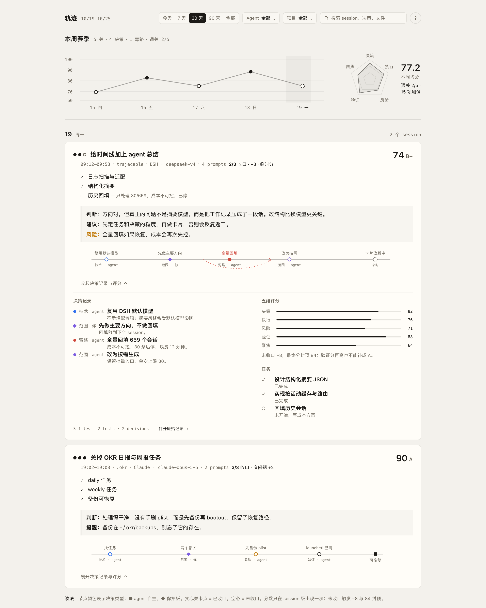

# dsh-trajecable

A Stage Log of what your local coding agents did. It reads the session logs that
DSH, Claude Code, Codex, Pi, Epi, Grok and Antigravity already keep on disk, and
turns each session into one run: what it was trying to do, what closed, what is
still open, and how good the work was.



**Race Log design (proposal for 0.5.0):** [docs/race-design.md](docs/race-design.md), reviewed by Gemini 4 Argon and Opus 5.5. The racing screen is a mockup, not part of 0.4.0.

Open **Formula** in the left sidebar.

## What you see

The page is one column, not a dashboard:

- **Season strip**: the average session score for the selected range, how many
  sessions are scored and cleared, a daily score line, and a five-axis radar.
  Daily points are small circles; click one to jump to that day. The radar only
  appears when at least three sessions have a score.
- **Day groups**: sessions are anchored to their **last active day**, so a long
  run that spans several days appears once, on the day it last moved.
- **One card per session**:
  - goal pips (`●●○`) show solved, partial and open problems;
  - score and grade (`82 B+`);
  - state: `done`, `ongoing` or `blocked`; ongoing scores are marked
    **provisional**;
  - gate line: `2/3 closed`, the penalty/bonus, and the score cap;
  - the AI summary and the named problems;
  - **MY COMMENT**: a judgement, advice and risk written from the evidence;
  - a 40px decision route: colored nodes, agent circles, user diamonds,
    detours in red;
  - expand for the decision log, five dimension bars, prompts, files and
    commands.
- **Unscored sessions** show their first prompt and a **Summarize** button.
- **Open raw record** opens the original DSH session when one exists.

Filters: range (today, 7, 30, 90 days, all), agent, project, and free-text
search over titles, summaries, problems, files and commands.

## Scoring

One session is one score. The score is not a count of activity; completion comes
first.

The model returns a list of **problems** and each is `solved`, `partial`, `open`
or `abandoned`. The code then applies a completion gate:

- all problems solved: normal score;
- two or more problems all solved: `+2` multi-problem bonus;
- one or more problems still open: `-8` and a cap of **84**;
- no problems, or zero solved: cap of **60**;
- blocked: cap of **50**;
- ongoing: the same gate, plus a **provisional** marker.

The score is built from five dimensions:

| Dimension | Weight |
| --- | --- |
| Decision quality | 25% |
| Execution | 25% |
| Risk control | 15% |
| Verification | 20% |
| Focus | 15% |

Daily scores are a weighted mean of the day's five dimensions. A session's base
score is the weighted mean of its active days; each day's weight (1–10) is the
model's estimate of how much work that day held. The completion gate is applied
to that base to make the session's final score. Grades: A ≥ 90, A- ≥ 85,
B+ ≥ 78, B ≥ 70, C ≥ 60, else D.

The full rules, with a worked example, are in
[docs/scoring-and-live.md](docs/scoring-and-live.md).

History is **not** a sum of daily scores. It is the equal-weight mean of settled
session finals. A three-day session contributes one final, not three daily
entries. The top chart shows daily parts as small dots and the final score at the
last active day; the season average and radar use finals only, labelled
`按 session 结算` when that distinction matters.

If a session is still running, its score is provisional and is recomputed when
new activity arrives. The old version is replaced; the index is not an audit
log.

## Chat HUD (live, no LLM)

A flag button in the chat header opens a small flat Sector Cam in the empty
top-left corner of the chat, under the tabs. The road runs from the bottom left to the top right. It
counts nodes and never calls a model: each user input is a corner, LLM replies
move the car, failed tool calls put red gravel on that corner, and a yellow flag
means the agent waits for you. The big number is the speed: tokens per second
over the last 30 s of the turn; the top right shows the session's total tokens. It refreshes at once on every new
user message, LLM step, tool call or tool result. See [docs/scoring-and-live.md](docs/scoring-and-live.md).

## AI review

The page asks the official DeepSeek Flash model for one structured review per session:

```json
{
  "summary": "one or two sentences",
  "state": "done | ongoing | blocked",
  "problems": [{"title": "...", "status": "solved | partial | open | abandoned", "evidence": "..."}],
  "decisions": [{"type": "tech | scope | risk | detour", "by": "agent | user", "title": "...", "reason": "..."}],
  "days": [{"date": "YYYY-MM-DD", "did": "...", "closed": ["..."], "weight": 1, "scores": {"decision": 80, "execution": 80, "risk": 80, "verification": 80, "focus": 80}}],
  "comment": {"tone": "good | watch | bad", "verdict": "...", "judgement": "...", "advice": "...", "risk": "..."}
}
```

The code, not the model, computes the scores, completion gate and grade.
The model sees a compact digest of the session: user and assistant text, tool
names, files, commands, errors and local timestamps, capped at 24,000
characters. Full transcripts and tool output bodies are not stored.

- The newest 6 sessions in the selected range are summarized automatically.
- **Summarize N** reviews the next 30 pending sessions; press it again to
  continue.
- A session's **Summarize again** button calls the model again.
- One call is made per session version. The result is cached in the index
  against the session's last activity, timezone, prompt count and tool count.
- The summary call goes to `deepseek-official` / `deepseek-flash` unless
  `summaryProvider` and `summaryModel` say otherwise. It is the only network
  request the plugin makes.
- Antigravity exposes only conversation summaries, so its rows use the preview
  and cannot be scored from a transcript.

## How it works

```
~/.dsh/sessions/*/*/session.v*.jsonl[.zstd]          ─┐
~/.claude/projects/*/*.jsonl                          │
~/.codex/sessions/YYYY/MM/DD/rollout-*.jsonl          ├─ scan ─→ ~/.dsh/plugin-data/trajecable/index.json
~/.pi/agent/sessions/*/*.jsonl                        │             │
~/.epi/pi/sessions/*/*.jsonl                          │             ├─ GET /api/trajecable/timeline
~/.grok/sessions/*/<uuid>/                            │             ├─ GET /api/trajecable/session
~/.gemini/antigravity*/conversation_summaries.db     ─┘             └─ POST /api/trajecable/summary
```

The host folds raw events into one small record per session: times, cwd, title,
model, counts, short excerpts and the AI review. The page draws the Stage Log
from those records.

A scan runs:

- at startup, if the index is older than 1 hour;
- when the page opens, if the index is older than 2 minutes;
- every hour while DSH runs, when the index is older than 24 hours;
- when you press **Scan**.

A page-open scan runs in the background. The page shows the current index first,
then refreshes when the scan ends. A daily scan catches up on the next page open
if DSH was closed at the scheduled time.

DSH session files are small and compressed, so a changed file is read fully.
Claude, Codex, Pi and Epi files are plain JSONL and can be large, so a scan
continues from the byte offset of the last complete line. A half-written last
line is retried on the next scan. A Grok directory is read again when its summary
or updates file changes. Antigravity's SQLite summaries are queried on each scan.

## What is stored

The index is local JSON at `~/.dsh/plugin-data/trajecable/index.json`. It holds:

- session titles and the first 12 prompts (600 characters each);
- up to 60 written file paths and 24 commands with exit status;
- counts, times, model, branch and origin;
- the AI review: summary, problems, decisions, daily parts, comment, scores and
  cache metadata.

It never holds assistant messages, tool output bodies, transcripts or
credentials.

Claude subagent transcripts (`<session>/subagents/*.jsonl`) and Pi/Epi
`subagent-artifacts/` are skipped: the parent session already records that work.
Codex subagent rollouts are kept and marked as subagent work.

Antigravity only exposes conversation summaries: title, preview, timestamps and
workspace. Its step/tool store is protobuf and is not decoded. Grok Bot app
sessions are not local; only the `grok` CLI's `~/.grok/sessions` store is
scanned.

## Configuration

Set these keys on the plugin row in the profile patch:

```yaml
- insert:
    - id: dsh-trajecable
      name: '@local/dsh-trajecable'
      config:
        dataDir: ~/.dsh/plugin-data/trajecable
        dshDir: ~/.dsh/sessions
        claudeDir: ~/.claude/projects
        codexDir: ~/.codex/sessions
        piDir: ~/.pi/agent/sessions
        epiDir: ~/.epi/pi/sessions
        grokDir: ~/.grok/sessions
        antigravityDirs:
          - ~/.gemini/antigravity/conversation_summaries.db
          - ~/.gemini/antigravity-ide/conversation_summaries.db
          - ~/.gemini/antigravity-cli/conversation_summaries.db
        pageScanIntervalMinutes: 2
        scanIntervalHours: 24
        summaryProvider: deepseek-official   # optional; this is the default
        summaryModel: deepseek-flash         # optional; this is the default
        summaryMaxTokens: 2000
        summaryTimeoutMs: 90000
```

`CLAUDE_CONFIG_DIR`, `CODEX_HOME`, `PI_SESSION_DIR`, `EPI_HOME`,
`EPI_SESSION_DIR` are respected. `DSH_TRAJECABLE_DIR` overrides `dataDir`.
`antigravityDir` is a single database; `antigravityDirs` is the list form.
Summary configuration is optional. By default the review uses the official
DeepSeek provider that every DSH install ships (`deepseek-official` /
`deepseek-flash`), not the model of the current chat. If that provider has no
credential, the Summarize button shows the provider's error.

## Install

Install it into the DSH profile:

```sh
cd ~/.dsh/profiles/desktop
pnpm add file:/Users/byronwayne/Projects/sides/dsh-plugins/trajecable-plugin
```

Then enable **dsh-trajecable** in Settings → Plugins and reload the page. The
installed copy is updated by the plugin manager; after changing the source,
rebuild, then reinstall or toggle the bundle so the host reloads.

## Limits

- One session is one log file or one Grok/Antigravity directory row. DSH sessions
  split by workspace directory, Claude by project, Codex by rollout, and Pi/Epi
  by process.
- A long session is scored once and anchored to its last active day. Earlier
  days do not repeat the score.
- Scores are model judgements from a capped digest, not proof of correctness.
  The completion gate only sees the problems the model recorded.
- Automatic reviews cover the newest 6 sessions per page load. The rest need
  **Summarize N** or the per-session button; this keeps a page open from making
  unbounded model calls.
- Token counts and costs are not shown. Use the usage plugin for those.
- Test counts come from command names (`npm test`, `pytest`, `go test`, ...).
  A test run through a custom script is not counted.
- Antigravity rows have no file, command or test data and cannot be reviewed
  from a transcript.

## Test

```sh
npm install
npm test
```

The suite builds the host and client bundles, then runs adapter, scan, timeline,
route, scoring, summary and UI tests on fixtures. It covers DSH, Claude, Codex,
Pi, Epi, Grok and Antigravity formats. The current suite has 23 tests.

For a real-data scan without the UI:

```sh
node --input-type=module -e "
import { createStore } from './src/host/store.js'
import { scanSources } from './src/host/scan.js'
const store = createStore({ dir: '/tmp/trajecable-check' })
console.log(await scanSources({ store }))
"
```
